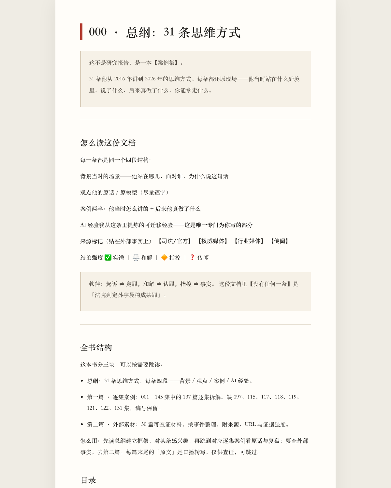
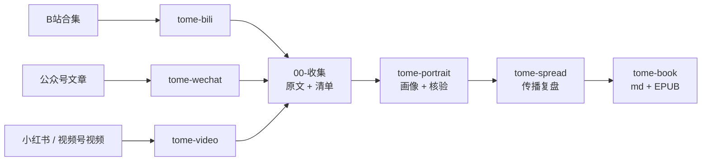

<div align="center">

# tome

**把公开资料，整理成一本能读的书。**

采集 → 人物解构 → 传播复盘 → EPUB 成书

一套给 [Claude Code](https://claude.com/claude-code) 用的技能（skills），不是独立应用。

[](LICENSE)
[](https://www.python.org/)
[](https://claude.com/claude-code)

作者：[ink](https://github.com/ink110)

</div>

---

## 这是什么

你在 B 站、公众号上看到一个人的大量公开分享——演讲、访谈、文章。它们散落在几百个视频和链接里，看完就忘，也没法检索。

tome 把这条路径自动化：

1. **采集**：B 站合集 / 公众号专辑 → 带时间戳的原文 + 元信息清单
2. **解构**：把一个人的公开表达拆成「思维操作系统」——分类、条目、案例、金句
3. **核验**：每条结论标来源层级，起诉 ≠ 定罪，传闻 ≠ 事实
4. **传播复盘**：筛出真正传播广的内容，拆钩子、结构、故事模板
5. **成书**：合并成一本排好版的 EPUB，可以直接放进微信读书

它不是「一键生成一本书」。中间有三个人工闸门，采集和核验不能跳过。

## 效果

<table>
<tr>
<td width="50%"></td>
<td width="50%"></td>
</tr>
<tr>
<td align="center"><sub>自动生成的封面（1200×1800）</sub></td>
<td align="center"><sub>成书后的总纲页</sub></td>
</tr>
</table>

以上来自一个真实项目：把 137 集 B 站演讲采集、解构成 31 条思维方式、30 篇外部核验材料，
最后生成一本可进微信读书的 EPUB。

## 一条完整链路



每个环节都能单独用：

- 只要字幕和播放数据 → 用 `tome-bili`
- 只想把公众号存进知识库 → 用 `tome-wechat`
- 小红书 / 视频号视频转成图文笔记 → 用 `tome-video`
- 已有语料，只缺一本电子书 → 用 `tome-book`

## 快速开始

**1. 安装**

```bash
git clone https://github.com/ink110/tome.git ~/tome
cd ~/tome && ./install.sh
```

`install.sh` 会把 7 个技能软链到 `~/.claude/skills/`，之后 `cd ~/tome && git pull` 就能更新，
开新会话即生效。目标已存在时会先备份再替换；想复制一份而不是软链，加 `--copy`。

> 技能在会话启动时发现，安装完记得开一个新会话。

**2. 配置**

```bash
python3 ~/.claude/skills/tome/scripts/setup.py
```

只问三个问题：项目放哪、用不用 Obsidian、用哪个模型。全部有默认值，一路回车也能跑。

**3. 预检**

```bash
python3 ~/.claude/skills/tome/scripts/doctor.py
```

检查 Python、pandoc、Chrome、B 站 cookie、模型连通性。缺什么会直接告诉你怎么补。

**4. 开始用**

在 Claude Code 里直接说：

```text
用 tome 把这个 B 站合集做成一本人物书
用 tome 把这个公众号专辑整理成书
用 tome 把已有项目重新导出 epub
```

## 两个选择

### 模型：三档，默认零配置

| 档位 | 怎么工作 | 需要准备 | 适合 |
| --- | --- | --- | --- |
| **`claude`（默认）** | 脚本只落原文，蒸馏和打标签由 Claude Code 直接完成 | 无 | 第一次用、几十篇以内 |
| **`openai`** | 调用任意 OpenAI 兼容接口（DeepSeek / Kimi / GLM / OpenAI） | 一个 API Key | 几百篇批量 |
| **`ollama`** | 调用本地模型 | 安装 Ollama + 拉模型 | 内容不出本机 |

切换只改配置，不用改命令：

```bash
python3 ~/.claude/skills/tome/scripts/setup.py --provider openai \
  --base-url https://api.deepseek.com/v1 --model deepseek-chat
export TOME_API_KEY=sk-...
```

API Key 只从环境变量读取，不会写进配置文件，更不会进仓库。

### 信息源：Obsidian 可选

| 模式 | 目录 | 链接 | 适合 |
| --- | --- | --- | --- |
| **普通文件夹（默认）** | `<工作目录>/<专题>/` | 普通 Markdown 链接 | 没有 Obsidian，或不想被库结构绑住 |
| **Obsidian** | `<库根>/topics/<专题>/` | `[[双链]]` + `index.md` | 已经在用 Obsidian 管知识库 |

两种模式的目录结构完全一样（`00-收集` / `10-画像` / `20-输出` / `assets`），
所以随时可以切，不会锁死在某一个工具里。

```bash
# 切换成 Obsidian 模式
python3 ~/.claude/skills/tome/scripts/setup.py --vault ~/Documents/我的库
```

### 媒体：Eagle 可选

公众号的图片 / GIF / 视频默认存到项目内的 `assets/`，用标准 Markdown 引用，**不需要 Eagle**。
如果你本来就用 Eagle 管理素材，可以在配置里打开，它会额外上传一份并保留溯源链接。

## 七个技能

| 技能 | 角色 | 做什么 |
| --- | --- | --- |
| `tome` | 中枢 | 判断你在哪一步，只加载对应的子技能；不直接采集或排版 |
| `tome-bili` | 采集 | 单视频 / 多分 P / 合集批量 → 字幕、口播稿、播放数据、清单 |
| `tome-wechat` | 采集 | 单篇 / 专辑 / 账号列表 → 笔记 + 媒体 + 阅读卡片 + 去重 |
| `tome-video` | 采集 | 小红书视频 / 视频号 / 本地视频 → 口播转写 + 关键帧 + 图文笔记 |
| `tome-portrait` | 解构 | 来源地图 → 分片调研 → 六类画像 → 核验表 → 三次人工闸门 |
| `tome-spread` | 传播 | 筛出真正传播广的内容，输出案例卡、选题清单、结构模板 |
| `tome-book` | 成书 | 合并 Markdown + 构建 EPUB，表格转卡片、口播分段、目录校验 |

## 先跑一下示例

`examples/mini-demo/` 是一个可以离线跑通的虚构项目（3 篇口播稿 → 一本 EPUB），
不需要 cookie，不需要 API Key：

```bash
python3 ~/.claude/skills/tome-book/scripts/build_book.py \
  --config examples/mini-demo/book.json \
  --out ./mini-demo.epub
```

看到「全部通过」，说明你的环境已经能成书了。细节见 [examples/mini-demo/README.md](examples/mini-demo/README.md)。

## B 站 cookie（只影响 B 站采集）

公众号流程不需要 cookie。B 站字幕和播放数据需要登录态：

1. Chrome / Edge 安装 **Get cookies.txt LOCALLY**
   （[Chrome 应用商店](https://chromewebstore.google.com/detail/get-cookiestxt-locally/cclelndahbckbenkjhflpdbgdldlbecc)，开源、不联网）
2. 登录 bilibili.com
3. 点扩展 → Export → 选 **Netscape** 格式 → 保存为 `~/.bilibili-cookies.txt`

必须导出**完整** cookie（SESSDATA、DedeUserID、bili_ticket 等），只拷 SESSDATA 会返回 -101。
这个文件只在你本机，不要提交到任何仓库。

## 常见问题

**需要付费 API 吗？**
不需要。默认 `claude` 档位由你正在用的 Claude Code 完成蒸馏，不额外调用模型。

**没有 Obsidian 能用吗？**
能。默认就是普通文件夹模式。

**没有 Eagle 能用吗？**
能。默认把媒体存到项目 `assets/`。

**Windows / Linux 支持吗？**
目前只在 macOS 上完整测试。脚本是纯 Python，路径都已配置化，Linux 大概率可用但未充分测试。

**为什么公众号文章没有阅读量？**
微信不公开阅读、在看、转发数。tome 不估算，改用可核验的代理指标（站外转载、后续引用、独家材料）。

**采集速度慢吗？**
公众号 200+ 篇串行大约 1–2 小时，会产生数千张图。B 站合集按集分批，可以中断续跑。

## 目录

```text
tome/                中枢：阶段判断、调度、交接物约定
tome-bili/           B 站采集脚本 + 解析参考
tome-wechat/         公众号采集、阅读卡片、媒体去重
tome-video/          小红书 / 视频号视频 → 口播 + 关键帧 → 图文笔记
tome-portrait/       来源地图、画像规格、核验、项目初始化
tome-spread/         传播筛选、案例卡、选题模板
tome-book/           EPUB 构建器、校验器、封面生成、排版规则
examples/mini-demo/  可离线跑通的虚构示例
docs/images/         README 用图
```

## 依赖

| 依赖 | 用途 | 必需 |
| --- | --- | --- |
| Python 3.9+ | 全部脚本 | 是 |
| Claude Code | 运行技能 | 是 |
| pandoc 3.x | EPUB 构建（自动探测） | 成书时 |
| Google Chrome | 自动生成封面 | 可选 |
| Ollama | 本地模型档位；`tome-video` 的画面描述用 `qwen3-vl` | 可选 |
| ffmpeg + mlx_whisper | 视频抽帧与口播转写（Apple Silicon） | 视频转笔记时 |
| yt-dlp | 下载小红书等站点视频 | 视频转笔记时 |
| Node + puppeteer-core | 抓视频号元数据 | 仅视频号 |
| Eagle | 素材管理 | 可选 |

`doctor.py` 会逐项告诉你缺什么。

## 设计原则

- **原话不改**：引语逐字，概括标「转述」。
- **起诉 ≠ 定罪**：未经司法认定的定性不写进画像正文。
- **不估算数据**：平台不公开的数就不写，用代理指标代替。
- **断点续跑**：先读 `progress.md`，从第一个未勾选项继续，不重爬、不重写。
- **最小加载**：一个项目内技能总数 ≤ 10，按阶段只加载需要的。

## 边界与合规

这个仓库只包含工具，**不包含任何抓取到的文章、字幕或媒体**。

- 仅用于个人学习、研究、评论等合理使用场景，不要二次分发抓取内容。
- 不绕过付费墙、登录墙或平台访问限制，抓取频率请自行控制。
- 抓取内容的著作权归原作者与平台所有；生成的书仅供自己阅读。
- 涉及真实人物时，只基于其公开言论，并区分事实、指控与传闻。
- 使用前请确认符合目标平台的服务条款与当地法律。

## License

[MIT](LICENSE)
